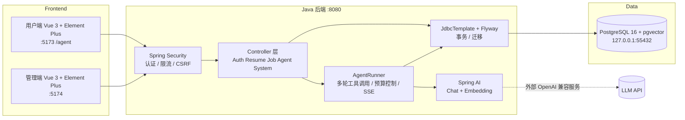

# ResuMe —— 智能简历分析系统

> ResuMe 是一个大模型驱动的简历智能分析与招聘辅助系统。招聘者上传简历，AI Agent 自动完成简历信息抽取、岗位（JD）解析、候选人检索、多轮补充调查与面试问题生成；所有结论均附可追溯的证据引用。
>
> 本仓库当前主线为 **AI Agent 版本**：以 Spring Boot + Spring AI 为核心，完整技术栈为 **Spring Boot · Spring AI · Spring Security · PostgreSQL · pgvector · Flyway · JdbcTemplate · Docker**。

---

## ✨ 简介

传统简历解析工具只是"填表"：把 PDF 文本丢给模型，返回一组固定字段。ResuMe 的 Agent 版本在此基础上更进一步，构建了一个**可自主规划、选择工具、多轮执行并自我校验**的智能工作流：

- **多轮工具调用**：Agent 不是单次问答，而是在预算约束内自主选择工具（候选人检索、证据读取、JD 查询等），多轮补充调查直至满足任务要求；
- **证据驱动**：简历解析结果与纠错记录均以向量证据形式落库，Agent 的每一项结论都要求真实检索并引用原文，禁止凭空编造；
- **人机协作**：Agent 生成报告草稿后必须人工审批，支持"澄清"交互与版本过期机制，关键决策始终保留人工入口。

## 🚀 功能特性

### 简历处理
- 支持 **TXT / PDF / DOCX** 上传，一次最多 5 份、单份 10MB、50000 字符（PDF 最多 100 页）
- 调用真实大模型抽取姓名、年龄、联系方式、学历、学校、技能、奖项、教育/工作经历等中文结构化字段
- 简历证据向量化入库，支持**去重**、详情查看、统计图表与安全删除（含文件清理队列）

### 岗位与检索
- **JD 解析 / 确认 / 删除**，岗位要求结构化
- 关键词过滤 + 向量语义检索（pgvector），按工龄、学历、技能筛选
- **候选人合并**：多份简历命中同一人时自动归并展示

### AI Agent 工作台
- 真实工具选择、多轮补查、引用验证、面试问题生成（无自动录用/拒绝决策）
- 报告草稿 + 人工审批 + 版本过期；草稿必须基于成功检索且候选人已被召回
- 后台任务、SSE 实时进度推送、任务取消、澄清入口、租约恢复（崩溃后重放安全读步骤）

### 数据与安全
- **纠错版本链**：人工纠错生成新版向量证据并标记校对来源，历史原文保留但不再参与新版匹配
- Spring Security：BCrypt 密码哈希、HttpOnly Session、CSRF 防护、用户/管理员角色隔离
- 登录/注册限流（默认 30 次/分钟/来源 IP，内存有界，超限返回 429 + Retry-After）

## 🛠 技术亮点

| 技术 | 版本 | 在本项目中的作用 |
| --- | --- | --- |
| Java | 21 | 运行环境 |
| Spring Boot | 3.5.16 | 应用框架与自动配置 |
| Spring AI | 1.1.8 | 统一接入 OpenAI 兼容聊天模型与向量模型，支持函数调用（tool calling） |
| Spring Security | — | 认证鉴权、BCrypt、HttpOnly Session、CSRF |
| PostgreSQL | 16 | 主数据库（独立实例，端口 55432） |
| pgvector | pg16 镜像 | 1024 维证据向量存储与语义检索 |
| Flyway | V1–V5 | 数据库版本化迁移，可重复建库 |
| JdbcTemplate / TransactionTemplate | — | 持久化与事务边界（JPA 依赖保留、暂未使用实体映射） |
| Docker / Compose | — | 一键启动带健康检查的 pgvector 数据库 |
| PDFBox / POI | 3.0.7 / 5.4.1 | PDF / DOCX 文本提取 |

### 架构



**关键设计：**
1. **证据向量检索**：解析结果按片段向量化，Agent 的引用由代码校验"引用归属 + 原文存在性"，杜绝幻觉引用；
2. **预算沙箱**：单任务工具预算 8 次、轮次上限 5 轮、总预算 180 秒，防止失控调用；
3. **崩溃可恢复**：租约机制 + 只重放安全读步骤，避免重复写库；
4. **显式人工关口**：草稿审批、澄清流程、纠错来源标记，保证关键决策可追溯。

## 📁 项目结构

```
code/
├── java-backend/              # Java AI Agent 后端（本版本核心）
│   ├── pom.xml                # Maven 依赖（Boot 3.5.16 / Spring AI 1.1.8）
│   ├── compose.yaml           # pgvector 数据库容器
│   ├── dev.mjs                # 统一开发入口（check/test/test-real/run/admin）
│   ├── .env.real.example      # 环境变量模板（无密钥）
│   ├── src/main/java/com/iras/      # 控制器 / 服务 / Agent 运行器 / 安全配置
│   ├── src/main/resources/db/migration/   # Flyway V1–V5 迁移脚本
│   └── tools/                 # 备份与旧库只读审计工具
├── vue-ending-project/        # 用户端前端（注册/上传/简历/统计/Agent 工作台）
├── vue-admin/                 # 管理端前端（用户/简历管理）
├── migration/                 # 迁移计划与执行记录
├── MIGRATION_BASELINE.md      # 行为基准
└── PROJECT_GUIDE.md           # 旧 Django 阶段记录（历史参考）
```

## 📦 环境要求

- **JDK 21**（可通过 `JAVA21_HOME` 指定路径）
- **Maven**（可通过 `MAVEN_HOME` 指定路径）
- **Node.js**（运行 `dev.mjs` 入口与前端开发服务器）
- **Docker + Compose**（启动 PostgreSQL/pgvector 数据库）
- 可用的 OpenAI 兼容 **Chat 模型**（需支持工具调用与 JSON 输出）与独立 **Embedding 模型** API Key

## 🚀 快速开始（本地运行）

以下命令均在仓库根目录执行。

### 1. 配置环境变量

复制模板并填写自己的密钥（`.env.real` 已被 Git 忽略，**不要将密钥提交到仓库或发送到聊天中**）：

```console
copy java-backend\.env.real.example java-backend\.env.real
```

关键配置项：

| 变量 | 说明 |
| --- | --- |
| `DATABASE_URL` | 默认 `jdbc:postgresql://127.0.0.1:55432/iras_agent` |
| `DATABASE_USER` / `DATABASE_PASSWORD` | 数据库账号与强密码（Compose 与 Java 共用） |
| `OPENAI_BASE_URL` / `OPENAI_MODEL` / `OPENAI_API_KEY` | 聊天模型，需支持工具调用与 JSON 输出 |
| `EMBEDDING_BASE_URL` / `EMBEDDING_MODEL` / `EMBEDDING_API_KEY` | 独立向量模型（不可用聊天模型名代替） |
| `SERVER_PORT` | 默认 `8080` |
| `COOKIE_SECURE` | 本地 HTTP 用 `false`；**生产必须 HTTPS 并设为 `true`** |

### 2. 启动数据库

```console
docker pull pgvector/pgvector:pg16
docker compose --env-file java-backend/.env.real -f java-backend/compose.yaml up -d --wait database
```

数据库绑定 `127.0.0.1:55432`，数据卷名 `iras-java-agent_iras-agent-postgres`，启动时由 Flyway 自动完成 V1–V5 迁移。

### 3. 启动 Java 后端

```console
node java-backend/dev.mjs run
```

启动后健康检查：http://127.0.0.1:8080/api/health

### 4. 启动前端（另开两个终端）

```console
npm --prefix vue-ending-project install
npm --prefix vue-ending-project run dev -- --host 127.0.0.1 --port 5173 --strictPort
```

```console
npm --prefix vue-admin install
npm --prefix vue-admin run dev -- --host 127.0.0.1 --port 5174 --strictPort
```

### 5. 创建管理员

系统**无默认管理员账号**，在交互式终端执行（密码隐藏输入，不要在对话中发送密码）：

```console
node java-backend/dev.mjs admin
```

### 6. 访问

| 入口 | 地址 |
| --- | --- |
| 用户端（含 Agent 工作台） | http://127.0.0.1:5173/agent |
| 管理端 | http://127.0.0.1:5174/ |
| 后端健康检查 | http://127.0.0.1:8080/api/health |

> ⚠️ 浏览器请统一使用 `127.0.0.1`，避免与 `localhost` 混用导致 Cookie 失效。两端前端共用后端会话，切换登录会替换身份；后端重启后需重新登录。

## 🧪 测试

```console
node java-backend/dev.mjs check      # 检查环境与配置是否就绪
node java-backend/dev.mjs test       # 非 AI 测试套件（不调用模型）
node java-backend/dev.mjs test-real  # 真实模型测试（会产生 API 费用）
```

- 两种测试都需要真实 PostgreSQL；测试创建随机 schema 与临时目录，结束后仅清理自身资源；
- 真实套件只发送**合成资料**，不会上传真实个人简历；
- 备份工具自测：`node --test java-backend/tools/backup.test.mjs`；
- 旧库只读审计：`node --test java-backend/tools/legacy-audit.test.mjs`。

## 💾 数据备份

确认所有 Java 写入实例已停止后执行：

```console
node java-backend/tools/backup.mjs create --quiesced
node java-backend/tools/backup.mjs verify java-backend/backups/<快照目录>
```

备份包含私密数据，请妥善保护目录。`verify` 仅恢复到随机临时库并删除，不会覆盖运行库。

## ⚠️ 现状与边界（务必阅读）

当前为**核心链路已验证的开发原型**，不是生产交付完成版本：

- 上传为同步流程，无 OCR（扫描件明确失败）、无异步队列；
- 登录限流为单实例内存实现，生产需可信网关限流与全量脱敏审计；
- 检索分数不代表能力分数，引用是否足以支撑岗位要求仍需人工核对；
- 尚未完成：管理员浏览器全流程验收、完整故障回归、全量依赖扫描、标注集效果评测、远端 CI 与生产部署；
- 生产部署需 HTTPS、Secure Cookie、严格 CORS、秘密管理与密码轮换；禁止用 `docker compose down -v` 代替迁移或密码轮换。

## 📚 相关文档

- [java-backend/README.md](java-backend/README.md) —— Java 后端详细说明
- [MIGRATION_BASELINE.md](MIGRATION_BASELINE.md) —— 行为基准
- [migration/execution-report.md](migration/execution-report.md) —— 测试证据与执行记录
- [migration/plan.md](migration/plan.md) —— 任务状态
- [PROJECT_GUIDE.md](PROJECT_GUIDE.md) —— 旧 Django 阶段历史记录

---

**ResuMe** · 大模型驱动的简历智能分析与招聘辅助系统 · AI Agent 版
